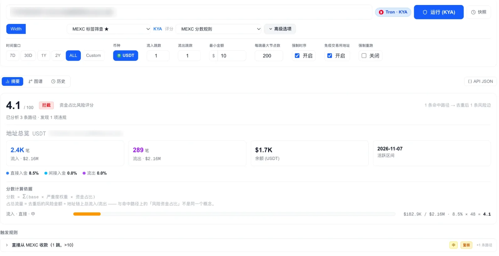

2026 年 11 月 6 日，美国财政部金融犯罪执法网络（FinCEN）依据《打击俄罗斯洗钱法》第 9714(a) 条，对 MEXC Global 发布命令：美国金融机构不得为其办理资金收付。命令在联邦公报刊登 30 天后生效。

当天，DART 就上线了对应的内置规则集，客户在控制台和 API 里可以直接选用。

## 先分清：这不是 OFAC 制裁

很多讨论把这次行动说成「制裁」，并不准确：

- 它是 **FinCEN 依 9714 条款发布的命令**，不是 OFAC 的制裁行动；
- MEXC **没有被列入 SDN 名单**，也**没有资产冻结**；
- 约束的是**美国金融机构**为其办理资金收付。

对合规团队来说，这个区别决定了处置口径：直接拦截、人工复核还是只做标记，要结合你和美国金融体系的业务往来、所在法域的要求来定。具体口径建议和你的法律顾问确认。

## DART 怎么处理

- **内置规则集，直接选用。** 规则集已收录这次行动涉及的实体，筛查时选中即可，也可以复制一份按自己的口径改分值和处置。
- **不会被「交易所豁免」放过。** DART 默认对交易所对手方豁免，但这次行动涉及的地址在默认设置下**不会**因此被直接判为通过。
- **多跳也能看到。** 资金路径经过相关地址时，结果里会标出在第几跳、涉及多少金额、占资金多少。

## 为什么能当天上线

DART 的规则全部公开、可读，规则集是数据，不是写死在代码里的逻辑。新的官方动作出来，我们只需要把涉及的实体和地址收录进标签库，再发布一套内置规则集，客户侧不用改一行代码。

这也是我们一直强调的：**规则要跟得上监管的速度，而且要说得清为什么拦。**

---

想看看你的充提里有没有相关资金？[联系我们](/zh/contact/)免费接入，接入即免费用到 2028 年 12 月 31 日。
