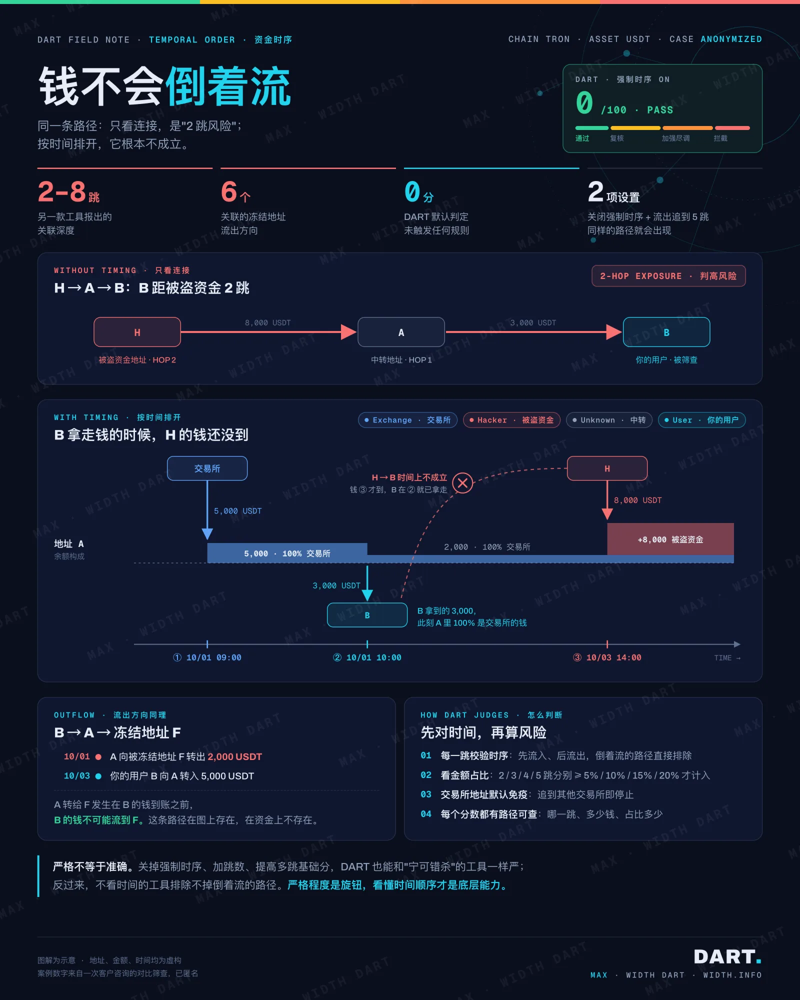

最近，一位客户的技术负责人在群里问了我们一个很好的问题。

他拿同一个 TRON 地址，分别用另一款 KYT 工具和 DART 查了一遍：

- **另一款工具：** 这个地址的资金流出方向关联了 6 个被 Tether 冻结的地址，近的 2 跳，远的 8 跳，涉及金额约 11 万美元，判「中低风险、建议复核」。
- **DART（默认配置）：** 0 分，通过，未触发任何规则。

是 DART 漏掉了吗？

## 一、调两项设置，风险就「出现」了

我们在 DART 里把同一个地址再查了一遍，这次**关闭「强制时序」**，并把流出方向的追溯从 1 跳加到 5 跳。

结果，那些冻结地址、制裁地址的关联路径全部冒了出来，触发了「冻结地址暴露」「制裁地址暴露」等多条规则，和另一款工具看到的基本一致。

**两边看到的是同一张链上数据。差别在于：要不要尊重资金的时间顺序。**

把这些路径逐笔拆开、对上每一笔转账的时间之后，结论很清楚：**这些路径上的钱，是倒着流的。**

## 二、钱不会倒着流

看一个简化的例子（地址和金额均为示意）。

**流入方向：**

| 时间 | 发生了什么 |
|-|-|
| 10 月 1 日 09:00 | 地址 A 从交易所提币 5,000 USDT |
| 10 月 1 日 10:00 | A 转给 B 3,000 USDT（B 是你的用户） |
| 10 月 3 日 14:00 | 一个被盗资金地址 H 向 A 转入 8,000 USDT |

只看连接关系：H → A → B，B 距离被盗资金 2 跳，判高风险。

加上时间：B 收到的 3,000 USDT 发生在 10 月 1 日，那时 A 里只有从交易所提出来的钱；H 的钱两天后才到。**B 收到的钱里，不可能有一分是被盗资金。**

**流出方向也一样：**

| 时间 | 发生了什么 |
|-|-|
| 10 月 1 日 | 地址 A 向一个被冻结地址 F 转出 2,000 USDT |
| 10 月 3 日 | 你的用户 B 向 A 转入 5,000 USDT |

只看连接关系：B → A → F，B 的资金「流向了」被冻结地址，2 跳。

加上时间：A 转给 F 的那笔，发生在 B 的钱到账之前。**B 的钱不可能流到 F。**

这些路径在图上存在，在资金上不存在。

## 三、为什么不看时间，几乎所有地址都「高风险」

链上是一张高度连通的网：热门中转地址、交易所热钱包、DEX、跨链桥，每天都和成千上万个地址交互。

如果只按连接关系往外扩，几乎总能碰到某个风险地址，跳数越多越是如此。上面这个例子里，另一款工具一路追到了 8 跳。再叠加「跳数越远分越低、但仍然加分」的打分方式，结果就是：**大部分地址都会带上风险分。**

这样做看起来很严格，代价却很高：

- **告警泛滥。** 合规团队每天复核大量「有风险」的地址，其中绝大多数是误报。
- **误伤好用户。** 复核不过来，就只能一律延迟或拦截，正常用户的充值、收款被卡住。
- **真风险被淹没。** 当所有地址都是红色，红色就不再有意义。

**严格不等于准确。** 这条路我们早期也走过。

## 四、DART 怎么判断

1. **按时间顺序追资金。** 每一跳都必须满足「先流入、后流出」：只有在资金转出之前已经到账的钱，才会被算进这条路径。倒着流的路径直接排除。
2. **看金额占比，而不只是「有没有连接」。** 风险资金在这笔钱里占多少，才是关键。跳数越远，门槛越高：2 / 3 / 4 / 5 跳的风险占比分别达到 5% / 10% / 15% / 20% 才计入。
3. **交易所地址默认豁免。** 路径追到其他交易所就停止，因为交易所有自己的 KYC 和风控，不会因为「某个交易所用户曾经碰过风险地址」就牵连到你。
4. **每个分数都有路径可查。** 命中了哪条路径、在第几跳、多少金额、占比多少，全部展示出来。合规同事可以据此做决定，也能向监管解释。
5. **规则可以按业务自定义。** 流入、流出各追几跳（默认流入 3 跳、流出 1 跳，可调），是否强制时序，各类风险的基础分和占比，都可以按业务调整。

## 五、想要更严？也可以

不同业务对「严」的要求本来就不一样：大额出金、托管签名前可以调严；小额充值、日常收款可以适当放宽。

如果你更习惯「宁可错杀」的口径，就像上面那样：在 DART 里关闭强制时序、增加追溯跳数、提高多跳命中的基础分，结果会和这类工具基本一致。

**反过来却做不到**：一个不看时间的工具，没办法把「倒着流」的路径排除掉。

**严格程度是一个可以按业务调节的旋钮；看懂资金的时间顺序，才是底层能力。**

---

DART 已覆盖 11 条链上的 USDT / USDC，2 亿个已标注地址，72 条风险规则，支持控制台、API、MCP 接入。手里有「判得太严」的地址，欢迎[发给我们](/zh/contact/)，一起逐笔拆开看。
