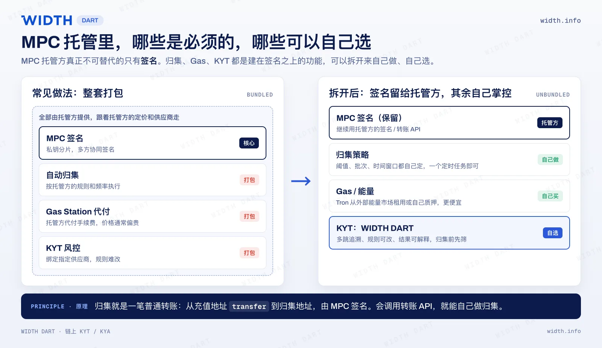
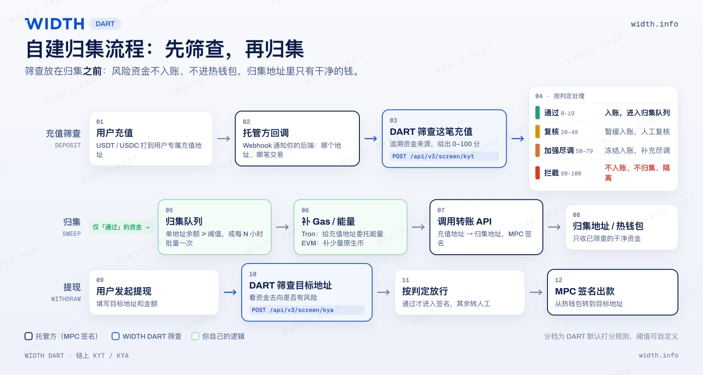
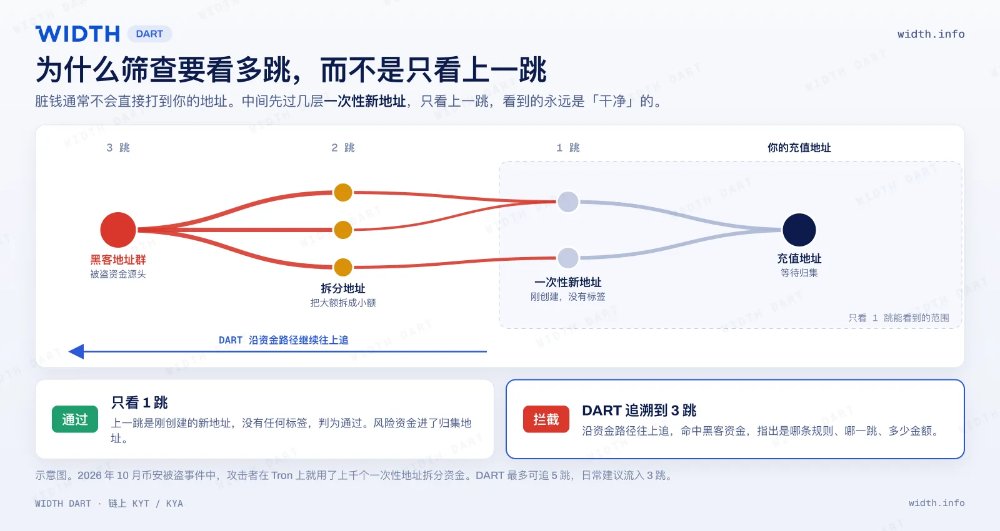

> 写给使用 MPC 托管钱包的团队：支付、U 卡、交易所、钱包都适用。这篇讲三件事：归集的原理，怎么自己做归集，以及在哪一步接入 DART 做 KYT。

MPC 托管方负责签名，归集可以自己做。自己做归集，主要有两点不同：

1. **KYT 自己选。** 规则、阈值、追溯跳数都由自己定。归集前先用 DART 筛查，风险资金就不会进热钱包。
2. **手续费更便宜。** 托管方代付手续费的价格通常偏贵。Tron 上从外部能量市场租能量，或者自己质押 TRX，成本更低。

## 一、MPC 托管到底帮你做了什么

MPC 托管解决的是私钥安全：**私钥分片保管，多方协同签名**。完整私钥不会出现在任何一台机器上，这部分建议继续交给托管方。

归集在链上看，就是一笔普通转账：从用户的充值地址转到你的归集地址。Tron 上是一笔 TRC20 `transfer`，EVM 链上是一笔 ERC20 `transfer`，签名由 MPC 完成。

托管方提供的「自动归集」，拆开来就是三步：

1. 一个定时任务，找出余额够了的充值地址；
2. 给这些地址补上手续费（Tron 上是能量和带宽，EVM 上是原生币）；
3. 调用托管方的签名接口，把钱转走。

这三步用托管方开放的转账 API 都能自己做。



| 项目 | 整套打包 | 自己做 |
|-|-|-|
| 归集规则 | 按托管方的频率和阈值 | 阈值、批次、时间窗口自己定，可以按业务高峰调整 |
| 手续费 | 托管方代付，通常偏贵 | Tron 上从外部租能量或自己质押 TRX；EVM 上自己补原生币。成本看得见 |
| KYT | 托管方指定的供应商 | 自由选择，规则、阈值、追溯跳数都能自己定 |
| 筛查时机 | 取决于托管方的实现 | 先筛查、再归集，风险资金进不了热钱包 |

签名、密钥安全、托管方的转账 API 都照常用。换掉的只是签名之上的策略层。

## 二、自建归集：五步走

整体顺序是**先筛查，再归集**。



### 第一步：接收充值通知

用托管方的 Webhook 回调，或者定时拉取托管方的充值记录接口。每笔充值记下：链、交易哈希、充值地址、币种、金额。

### 第二步：用 DART 筛查这笔充值

把交易哈希提交给 DART，方向设为 `in`，也就是看这笔钱从哪来：

```json
POST https://api.width.live/api/v3/screen/kyt
X-Api-Key: YOUR_KEY

{
  "chain_name": "Tron",
  "tx_id": "充值交易哈希",
  "token": "usdt",
  "screen_direction": "in",
  "mode": "async"
}
```

异步模式会立刻返回一个 `job_id`，再用 `GET /api/v3/screen/result/{job_id}` 取结果。结果里有 0–100 的风险分、处置档位，以及命中了哪些规则、在第几跳、涉及多少金额。完整参数见 [API 文档](https://width.info/api-reference)，可以直接在页面上调试。

### 第三步：按判定处理

| 判定 | 分数 | 建议处理 |
|-|-|-|
| 通过 | 0–19 | 正常入账，进入归集队列 |
| 复核 | 20–49 | 暂缓入账，合规人员看一下命中路径再决定 |
| 加强尽调 | 50–79 | 冻结入账，请用户补充资金来源材料 |
| 拦截 | 80–100 | 不入账、不归集，资金留在原地址或转入单独的隔离地址，等合规结论 |

分档是 DART 默认打分规则，阈值可以按你的风险偏好改。

**为什么拦截的钱不能归集：** 热钱包一旦混进风险资金，别人再筛你的热钱包，也会查到这笔关联。交易所、银行、合作方都可能因此拒收或要求解释。先筛再归集，热钱包里就只有干净的钱。

### 第四步：补手续费

**Tron：** USDT 转账消耗能量和带宽。地址里没有能量时，会直接燃烧 TRX 抵扣，这是最贵的方式。更省的做法有两种：自己质押 TRX 换能量，再委托给要归集的充值地址，归集完收回委托；或者从能量租赁市场按需租用。上线前拿外部能量市场的报价和托管方的价格对比一次，按每月归集笔数算一下能省多少。

**EVM 链：** 充值地址里没有 ETH、BNB 这类原生币就转不动 USDT，需要先从一个专门的 Gas 钱包补少量原生币。

**省钱技巧：** 设一个最小归集金额，金额太小的先攒着，避免手续费比归集金额还高。

### 第五步：调用托管方转账 API 归集

从充值地址转到归集地址，由 MPC 签名。每笔归集记下交易哈希、金额和对应的 DART 筛查结果。DART 每次筛查都会自动生成不可篡改的快照，审计时可以直接回查。

```python
# 每 N 分钟跑一次
for addr in deposit_addresses:
    deposits = pending_deposits(addr)              # 已入账、待归集的充值
    if any(d.verdict != "pass" for d in deposits):
        continue                                   # 有未通过的，整个地址先不动
    balance = custody.get_balance(addr, "USDT")
    if balance < MIN_SWEEP_AMOUNT:
        continue                                   # 金额太小，先攒着
    ensure_fee(addr)                               # Tron 委托能量 / EVM 补原生币
    tx = custody.transfer(addr, COLLECT_ADDRESS, "USDT", balance)   # MPC 签名
    save_sweep_record(addr, tx, deposits)          # 关联 DART 筛查结果，留档
```

### 提现：签名前先筛目标地址

用户提现时，签名之前先用 DART 筛一下目标地址（`POST /api/v3/screen/kya`），看资金去向有没有风险。通过才进入签名，其余转人工。**充值看来源，提现看去向。**

## 三、为什么筛查要看多跳

脏钱很少直接打到你的地址。常见做法是先拆成小额，再经过几层刚创建的一次性地址，最后才充值。只看上一跳，看到的就是一个没有任何标签的新地址，判为通过。



DART 的追溯跳数可以按需配置，日常筛查建议流入 3 跳、流出 1 跳，速度和覆盖比较平衡。

## 四、怎么开始

1. [联系我们](/zh/contact/)开通 DART 账号，接入即免费用到 2028 年 12 月 31 日。
2. 在控制台创建 API Key。
3. 先拿过去一个月的历史充值跑一遍，看分数分布，确定自己的阈值。
4. 把筛查接进充值和提现流程，上线自建归集。

已经在用其他 KYT 的，可以先并行跑一段时间，对比两边的结果再决定。接入过程中有问题，我们的工程师全程支持。
